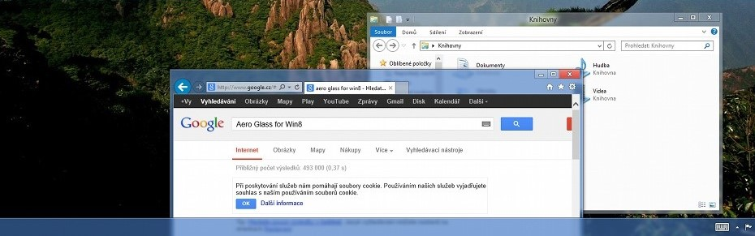

# Aero-Glass-to-Win-10



Русскоязычная сборка и центр управления, объединяющие стеклянное оформление OpenGlass с встроенными компонентами меню «Пуск» на базе Classic Shell/Open-Shell. Проект предназначен для Windows 10 и возвращает эстетику Aero Glass без отдельной установки Classic Shell.

> [!WARNING]
> Проект загружает DLL-компонент в Desktop Window Manager (DWM) через системную службу. Это системно-критичный режим работы. Неподписанный установщик может показывать предупреждение SmartScreen.

## Содержание

- [Возможности](#возможности)
- [Поддержка и требования](#поддержка-и-требования)
- [Быстрая установка](#быстрая-установка)
- [Использование](#использование)
- [Производительность](#производительность)
- [Безопасность и восстановление](#безопасность-и-восстановление)
- [Частые проблемы](#частые-проблемы)
- [Сборка из исходников](#сборка-из-исходников)
- [Структура](#структура)
- [Лицензии](#лицензии)

## Идея проекта

Aero Glass — это интеграция двух направлений: стеклянного слоя OpenGlass, работающего через `OpenGlassHost.exe` и DWM, и встроенного меню «Пуск»/настроек на базе Classic Shell/Open-Shell. Это микс OpenGlass и Classic Shell в одном приложении, с единым русскоязычным центром управления.

## Возможности

- настройка Aero-оформления Windows;
- управление встроенным меню «Пуск» и панелью задач;
- русские ресурсы интерфейса и меню;
- автоматический запуск фоновой службы без открытия GUI при входе в Windows;
- ручной запуск GUI с запросом прав администратора только для административных операций;
- импорт и применение пресетов с проверками архива;
- готовые каталоги `Textures`, `Atlas`, `Button` и `Skins` в папке установки для самостоятельного выбора ресурсов;
- предусмотренные архитектурой резервирование и восстановление настроек.

## Поддержка и требования

Подтверждённая среда текущего аудита: Windows 10 Pro x64, build 19045 (22H2). Установщик ограничен Windows 10 build 17763 и новее, однако фактическая совместимость зависит от DWM-проекций и конкретного бинарника. Поддержка Windows 11 этим релизом не заявляется без отдельной проверки.

Для готовой сборки нужен x64 Windows и администратор для установки службы. Для сборки нужны Visual Studio/MSBuild с C++ toolset, Windows SDK 10.0, Python 3, vcpkg manifest и ATL/MFC workload для Start Menu-компонента.

## Быстрая установка

Скачайте `Aero-Glass-to-Win-10-Setup.exe` из Releases и запустите его от имени администратора. Установщик создаёт службу `OpenGlassHost`, устанавливает подходящий DWM DLL, добавляет ярлыки и запускает службу. GUI открывается ярлыком после установки.

Установщик не ставит рекламу или сторонние приложения. Пользовательские настройки не удаляются автоматически без выбора в мастере удаления; настройки других профилей Windows сохраняются.

## Использование

1. Запустите «Aero Glass» из меню «Пуск» или с рабочего стола.
2. Измените параметры и сохраните их штатной кнопкой приложения.
3. Для отдельных изменений может потребоваться перезапуск оболочки или выход из системы.
4. После перезагрузки Windows фон запускается службой; GUI сам не открывается и не показывает UAC при каждом входе.

## Производительность

Реальные наблюдения и ограничения собраны в [docs/PERFORMANCE.md](docs/PERFORMANCE.md). Полный повторяемый тест «до/после» с тремя сериями не завершён, поэтому проект не заявляет нулевую нагрузку и не выдаёт единичный снимок за benchmark.

В ходе аудита Explorer оставался отзывчивым; зафиксированы ориентиры около 0,3–0,5% CPU в одном интервале и около 0,05 CPU за отдельные 3 секунды. В тех срезах заметной загрузки `dwm.exe` и `OpenGlassHost.exe` не наблюдалось. Это диагностические снимки, а не гарантия для всех эффектов и конфигураций.

## Безопасность и восстановление

Изменение DWM и подключение оболочечных DLL может привести к нестабильности Explorer или DWM. Не отключайте защиту Windows и не заменяйте системные DLL вручную.

Для восстановления верните стандартные параметры в приложении и перезагрузите Windows. Если GUI не запускается, удалите Aero Glass через «Приложения и возможности»; установщик остановит и удалит службу. При серьёзной нестабильности используйте безопасный режим или точку восстановления.

## Частые проблемы

**После входа нет окна.** Это ожидаемо: служба работает в фоне, GUI не стартует автоматически, чтобы не вызывать UAC при каждом входе.

**Появляется UAC при ручном запуске.** GUI выполняет административные операции.

**SmartScreen показывает предупреждение.** Установщик не подписан сертификатом издателя. Проверяйте хэш и скачивайте файл только из официального Releases.

**Explorer или DWM перезапускается.** Остановите эффект, удалите приложение из безопасного режима и восстановите стандартное оформление.

## Сборка из исходников

```powershell
msbuild OpenGlass.slnx /m /restore /p:Configuration=Release /p:Platform=x64
```

Для локальных зависимостей может потребоваться `/p:VcpkgInstalledDir=... /p:VcpkgTriplet=x64-windows-static`. `OpenGlassRenderTest` — интерактивный GPU-тест, а не unit-test. Установку службы и инъекцию в DWM нельзя использовать как обычную проверку исходников.

## Структура

| Каталог | Назначение |
|---|---|
| `OpenGlass/` | DWM-код и projection schemas |
| `OpenGlassHost/` | Служба загрузки и жизненного цикла |
| `OpenGlassGUI/` | Графический центр управления |
| `OpenGlassStartMenu/` | Встроенный Start Menu на базе Open-Shell |
| `OpenGlassTests/` | Неинъекционные тесты |
| `Scripts/` | Сборка, аудит и упаковка |
| `docs/` | Документация и измерения |

## Лицензии

Основной проект распространяется по [LICENSE.txt](LICENSE.txt). Встроенный компонент на базе Open-Shell сохраняет отдельное уведомление в `OpenGlassStartMenu/OPEN_SHELL_LICENSE.txt`. Условия сторонних ресурсов необходимо читать вместе с соответствующими файлами лицензий.

## История и ссылки

База проекта — версия `3.0.2.3749`. В релизный слой вошли русскоязычный установщик, интеграция OpenGlass и Classic Shell/Open-Shell, исправления жизненного цикла Start Menu DLL и ленивый фоновой запуск без HKCU Run для GUI.

- [Репозиторий GitHub](https://github.com/dev2v07/Aero-Glass-to-Win-10-22h2)
- [Issues](https://github.com/dev2v07/Aero-Glass-to-Win-10-22h2/issues)
- [Releases](https://github.com/dev2v07/Aero-Glass-to-Win-10-22h2/releases)
